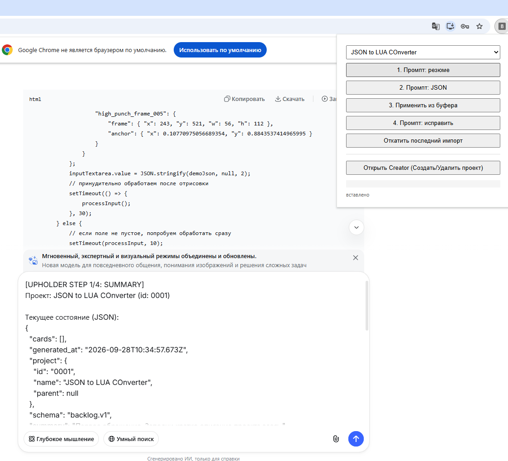
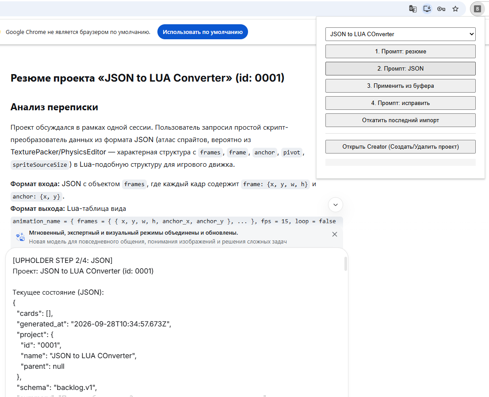
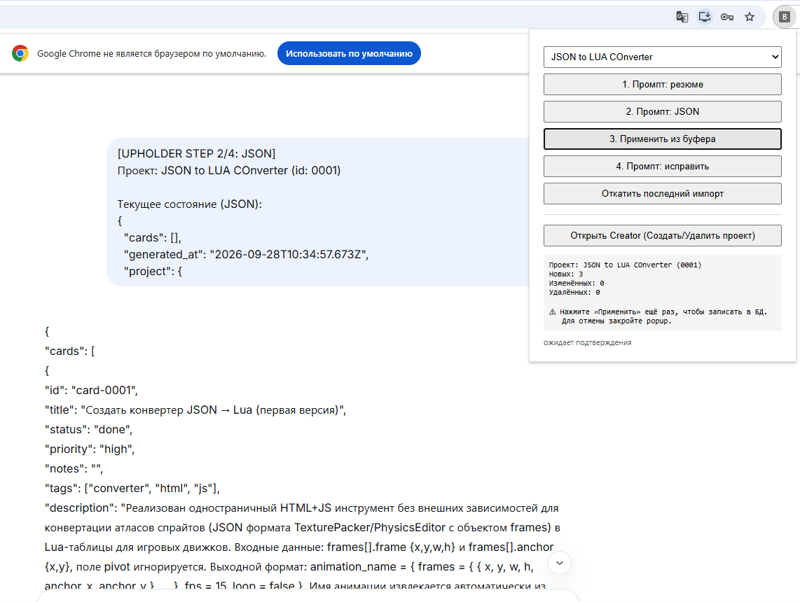
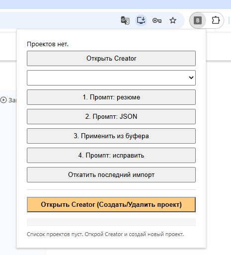
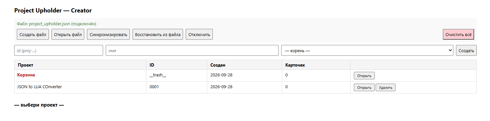
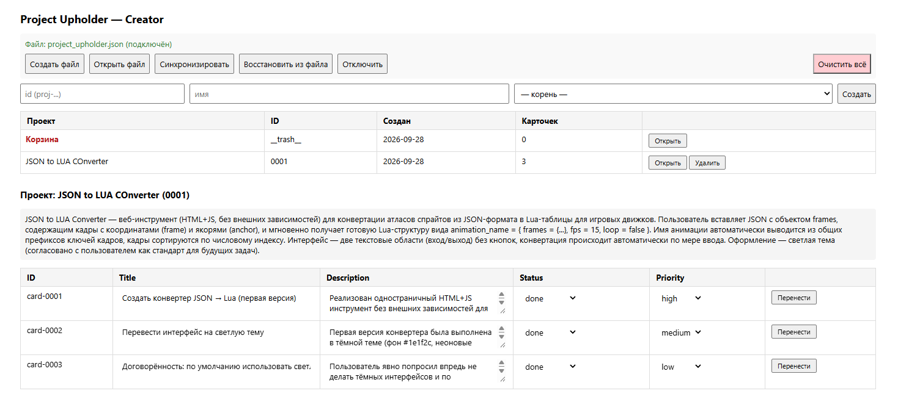
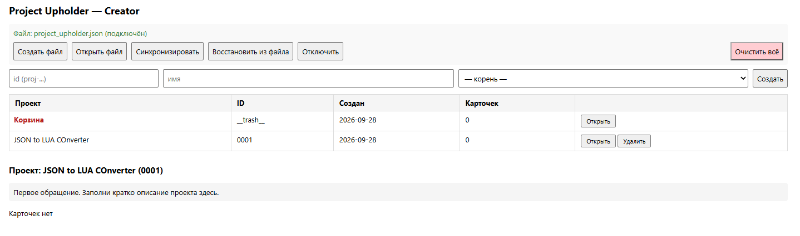

# Project Upholder

Браузерное расширение для ведения бэклога проектов через диалог с LLM.

Хранит проекты и карточки локально в браузере, вставляет шаблонные промпты в поле чата, принимает структурированный JSON от модели, показывает diff перед применением, поддерживает откат, дерево проектов, редактирование карточек, перенос между проектами и синхронизацию с файлом. Работает без бэкенда.

## Зачем это нужно

Работа с LLM в чате удобна, но состояние проекта живёт только в переписке. Через неделю уже не помнишь, что сделано, что в работе, а что забыли. Тяжёлые трекеры вроде Jira — избыточны для одиночного проекта и плохо сочетаются с форматом диалога.

Project Upholder — лёгкий слой управления бэклогом прямо в чате. Пользователь общается с моделью как обычно, но в нужный момент нажимает одну кнопку — и получает структурированное представление текущего состояния проекта. После применения карточки обновляются. Через месяц достаточно открыть файл, чтобы напомнить себе, что не сделано.

## Как это работает

Цикл из четырёх шагов. Каждый шаг — отдельная кнопка в popup. Между шагами — пользователь и чат с моделью. Никакой автоматизации без участия человека — осознанный выбор в пользу надёжности.

### Шаг 1. Резюме

Пользователь нажимает кнопку → расширение вставляет в поле чата промпт с текущим состоянием проекта. Модель читает проект и пишет текстовое резюме: что сделано, что в работе, что заблокировано.



### Шаг 2. JSON

Пользователь нажимает вторую кнопку → вставляется промпт с тем же состоянием проекта, но теперь модель возвращает новое состояние в структурированном виде.



### Шаг 3. Применение

Пользователь копирует ответ модели в буфер и нажимает третью кнопку. Расширение:

- разбирает полученный ответ,
- проверяет его по схеме,
- показывает diff (новые / изменённые / удалённые карточки),
- запрашивает подтверждение.

Повторное нажатие — запись в базу.



### Шаг 4. Исправление

Если проверка не прошла — кнопка «Промпт: исправить» вставляет в чат список ошибок вместе с отклонённым ответом. Модель исправляет. После этого пользователь возвращается к шагу 3.

## Установка

1. Скачать или склонировать репозиторий.
2. Открыть `chrome://extensions`.
3. Включить «Режим разработчика» (правый верхний угол).
4. Нажать «Загрузить распакованное расширение».
5. Выбрать папку `extension`.

После этого расширение появляется на панели Chrome.

Требуется Chrome 102+ (Manifest V3, `chrome.storage.session`, File System Access API).

## Быстрый старт

### Первый проект

Если реестр проектов пуст — popup показывает подсказку и подсвеченную кнопку «Открыть Creator».



В Creator:

1. Открыть раздел создания.
2. Ввести id (например, `proj-0001`), имя и выбрать родительский проект.
3. Нажать «Создать».

Проект появляется в таблице Creator. Карточек в нём нет — это нормально.



### Первый цикл

В popup:

1. Выбрать проект из выпадающего списка.
2. Нажать «1. Промпт: резюме». Текст вставляется в поле чата.
3. Отправить сообщение. Модель возвращает резюме.
4. Нажать «2. Промпт: JSON». Вставляется второй промпт с текущим состоянием проекта.
5. Отправить. Модель возвращает структурированный ответ.
6. Скопировать ответ в буфер.
7. Нажать «3. Применить из буфера». Появится diff.
8. Нажать ещё раз — изменения применяются. Карточки появляются в Creator.



### Дальше

- Карточки можно редактировать прямо в таблице Creator: название, описание, статус, приоритет.
- Карточки можно переносить между проектами через кнопку «Перенести».
- Последний импорт можно откатить кнопкой в popup.



## Структура проекта
```

extension/
├── manifest.json      — MV3, разрешения, точка входа
├── background.js      — service worker (минимум)
├── content.js         — вставка текста в поле чата
├── popup.html/js      — UI и логика четырёх шагов
├── creator.html/js    — визуальный помощник
├── db.js              — хранилище
├── schema.js          — проверка и сравнение состояний
├── prompts.js         — шаблоны промптов
└── fshandle.js        — File System Access API

```

Разделение ролей:

- popup — рабочий цикл (шаги 1–4).
- creator — визуальный помощник. Создание проекта, просмотр содержимого, редактирование карточки. Не для ежедневной работы.
- content — единственная связь с чатом. Только вставка текста.
- db — источник истины в памяти. Ничего не знает про UI.
- schema — проверка и сравнение состояний. Ничего не знает про хранилище.
- prompts — шаблоны. Ничего не знает про UI и хранилище.

## Синхронизация с файлом

Файл — снимок текущего состояния проектов. Хранится там, где удобно: локально, в облаке, на флешке.

Кнопки в Creator:

- «Создать файл» — выбрать, где будет лежать файл.
- «Открыть файл» — подключить существующий файл (например, после переноса на другую машину).
- «Синхронизировать» — записать текущее состояние в файл.
- «Восстановить из файла» — прочитать файл и восстановить проекты в памяти.
- «Отключить» — забыть связь с файлом. Сам файл на диске не трогается.

Защита от потери данных:

- При синхронизации проекты добавляются, а не перезаписываются вслепую.
- Совпадающие идентификаторы разрешаются без потери данных.
- Если память пуста, а файл не пуст — запрашивается подтверждение.

Служебный проект «Корзина»:

- Живёт только в памяти расширения.
- Не синхронизируется с файлом.
- Не отображается в popup.
- Доступен в Creator для просмотра и переноса карточек обратно.

## Ограничения

- Только Chrome (Manifest V3). Firefox потребует адаптации.
- Селектор поля ввода привязан к DOM чата. Работает для DeepSeek. Для других чатов предусмотрен ручной выбор поля через overlay.
- Корзина живёт в памяти. При потере хранилища расширения она пропадает.
- Синхронизация односторонняя (память → файл), слияние — по проектам.

## Что дальше

Возможные направления развития:

- Журнал изменений в файле вместо снимка — полная история применений.
- Синхронизация с внешним канбаном (Vikunja, Wekan) — отдельный процесс.
- Read-only аналитика поверх бэклога. Отчёты, приоритеты, застой.
- Экспорт и импорт проектов одним файлом.
- Версионирование промптов.
